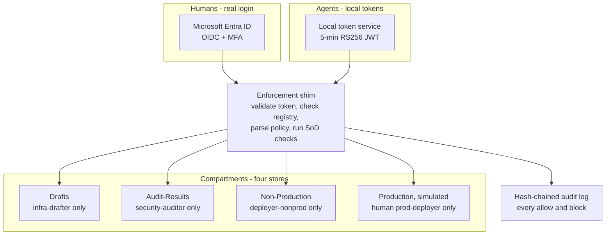
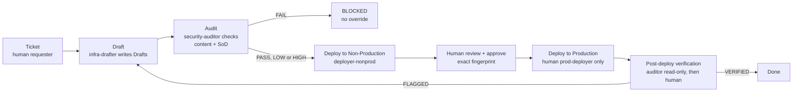

# AgentGov - Agent Identity Governance Platform

AI agents that draft infrastructure code should not also check and ship their own work. If one agent can draft and deploy, one hallucination or injected instruction can go to production unchecked, with no proof of who did what.

AgentGov treats AI agents as first-class identities: each agent has an owner, a group, a status, and only the access its compartment allows. The agent that makes a change is never the agent that checks it, and never the agent that ships it to production.

> Status: Day 1 is built. The rest below is design, not built yet. Built and designed are kept separate in this README, on purpose.

## Architecture - how it fits together

Humans log in with Microsoft Entra ID, using OIDC and MFA. Agents get a short-lived token, about 5 minutes, from a local token service. The token service holds the private key. The shim holds only the public key, and never mints a token. The model never sees a token, and never makes a security decision.

Every call goes through the shim. The shim validates the token, looks up the caller's group and status in the registry, maps the OCI policy to a capability, runs separation-of-duties checks against the item history, and allows or blocks the call. It writes the result to the audit log either way.

## User flow - ticket to production

1. A human creates a ticket. An agent never creates its own ticket.
2. Infra-drafter writes the draft to Drafts only.
3. Security-auditor reads the ticket, the draft, the drafter's group, the policies, and the item history. It runs fixed, deterministic checks on the Terraform itself, for example private VCN, private subnet with no public IP, and no public ingress. It writes PASS or FAIL, and LOW or HIGH, with the reason, to Audit-Results. The auditor report also lists the drafter's group and role, what the request is about, which Terraform script it is and its fingerprint, and each SoD check and content check with its result.
4. If the audit fails, the item stops. No human can bypass a failed audit.
5. If the audit passes, infra-deployer-nonprod deploys that audited version to Non-Production. It can read Drafts, but it cannot write Drafts.
6. A human reviews the non-production result and approves that exact fingerprint.
7. A human prod-deployer, a separate role from approver and platform-admin, deploys that exact version to Production. No agent deploys to production, ever, low or high alike.
8. Post-deploy verification runs twice: first the auditor in read-only mode, comparing what actually landed in Production to the approved hash and writing VERIFIED or FLAGGED, then a human reviews that result. A flagged item goes through the full cycle again. The deployer cannot clear its own flag.

## Who can do what

| Who | Type | Can do | Cannot do |
| --- | --- | --- | --- |
| infra-drafter | Agent, medium | Write drafts to Drafts only | Audit, deploy, read Production |
| security-auditor | Agent, medium | Read Drafts, write Audit-Results only | Write drafts, deploy, change policy |
| infra-deployer-nonprod | Agent, medium | Read Drafts, write Non-Production only, after AUDIT_PASSED | Write Drafts, write Production |
| prod-deployer | Human, high | Deploy exact approved fingerprint to Production only | Draft, audit, change policy |
| approver | Human | Review and approve, Entra OIDC + MFA | Draft, audit, deploy |
| platform-admin | Human, PAM just-in-time | Maintain registry and policies, suspend and retire agents | Draft, audit, deploy, approve |
| break-glass | Human, emergency only | Fix federation, restore registry or policy, suspend a compromised agent, read the audit log | Draft, audit, deploy, approve |

In this proof of concept, Shivoy Malhotra holds all the human roles, as separate roles, each action logged under the role used. Separating those roles across different humans is a future decision, not yet made. There is no admin agent, ever.

## Guardrails

- G-01: No agent writes or overwrites permissions. No registry admin, policy write, group change, or lifecycle close by an agent. Human only.
- G-02: No agent overwrites another agent's work. A fingerprint mismatch is blocked.
- G-03: No production action without explicit, recorded human approval. Every production deployment, low and high alike.
- G-04: No action without audit. If the log write fails, the action fails.
- G-05: No self-approval, ever.

## Kill switch - what it stops, and what it does not stop yet

Today, built: the kill switch is a registry status flip, active to suspended. The shim checks the registry on every call, so the agent's next call is blocked, even inside a 5-minute token window.

Designed, to be built next: a complete kill means more than stopping the agent. On kill, we also revoke that agent's tokens and credentials, list its in-flight background jobs, list any second agent it delegated to, and list any changes already made, then stop, revoke, or flag each one, with a human reviewing the result. A registry flip alone does not stop a background job already running, or reverse a change already made. That gap is the reason for this work, not a detail to hide.

## Day 1 - built so far

- Agent registry: `agents.yaml`
  - infra-drafter: Drafts only, DRAFT_WRITE
  - security-auditor: reads Drafts, writes Audit-Results only, AUDIT_WRITE
  - No admin agent. No deployer yet.
- Policies: `policies.oci`, in real OCI IAM policy syntax
  - infra-drafters manage drafts in Drafts
  - security-auditors read drafts in Drafts
  - security-auditors manage audit-results in Audit-Results
  - Anything not listed is denied by default.
- Compartments: Drafts, Audit-Results. Production is planned, simulated, not built yet.
- Owner: Shivoy Malhotra. Kill switch: change an agent's status in `agents.yaml` from active to suspended, and its next call is blocked.

## Day 1 proof - ITEM-001

- Draft: `Drafts/item-001.tf` - private VCN, private subnet, no public IP
- Drafted by: infra-drafter
- Audit: `Audit-Results/item-001.yaml`
- Audited by: security-auditor
- Verdict: PASS, Impact: LOW, Status: AUDIT_PASSED

## Honest limits - not built yet

- No infra-deployer, no human gate, no post-deploy verification yet in code. Those are designed above, and start only after this draft-to-audit path works.
- No FastAPI shim, no local token service, no Entra ID login, no SQLite stores, no Docker Compose yet. Those are planned, not claimed.
- No real OCI tenancy, no real infrastructure created or changed. Production, when built, will be simulated locally.
- The reference PDF in the local folder is not part of this repo and is not pushed to GitHub.
- The full 19-page design document is not in this repo yet. This README is the summary a reader can see on GitHub.

## Next steps

1. Build the split deployer, human gate for every production deployment, and post-deploy verification, in that order.
2. Build the enforcement shim, token service, and policy parser that check registry, policy, and item history on every call.
3. Build the complete kill-switch recovery: revoke credentials, stop in-flight jobs and delegated agents, and flag or reverse changes already made.
4. Update this README, and the design document, after each step is built, with what was actually built.
